# GridCrucible

**A KCL-KVL–compliant synthetic transmission-grid generator.** GridCrucible
builds synthetic transmission networks that satisfy *both* Kirchhoff laws
(current **and** voltage) by refining a fully connected candidate graph down to
a realistic network through three nested loops. It is the Python conversion of
the QNCA pipeline (`main_SRTV.m` / `MultiLevelProgram.m`) from Jonathan
Snodgrass's dissertation MATLAB codebase.

The refinement loops:

* **OHM Loop** — *Optimization Honoring KVL Minimization* (inner). A
  per-scenario QP with an L1 regularizer whose optimality conditions enforce
  KVL, solved with `gurobipy` plus a custom smoothed-L1 Newton step.
* **TUNE Loop** — *Thermal Updating of Network Elements* (middle). Conductor
  assignment, branch resizing, and transformer impedances so every element is
  thermally adequate for the flows the OHM loop produced.
* **TRIM Loop** — *Topology Reduction via Informed Metrics* (outer).
  Scenario-flow scoring, FERC Form 715 target-aware protection of realistic
  corridors, and stochastic removal of redundant lines until the network's
  graph metrics match a real interconnection.

Around those loops sit the supporting stages: load-profile scenarios, economic
dispatch, bus/substation creation, reactive-power (shunt) placement, AC
refinement, final power flow, realism metrics, and report writers — all wired
into a single resumable, checkpointed pipeline (`gridcrucible.core`).

## Relationship to GridForge

[GridForge](https://github.com/Snodgrass-Research-Group/GridForge-Public) is the
sibling generator for the **KCL-only** pipeline. The two projects share a small
set of low-level helpers — economic dispatch, R/X/B impedance, the conductor
catalog, and candidate/topology math.

So that this repository installs and runs on its own, GridCrucible **does not
depend on the GridForge package**. It carries a marked copy of just those shared
modules under [`src/gridcrucible/_gridforge/`](src/gridcrucible/_gridforge/)
(copied from GridForge 0.1.0). The adapters that reshape GridCrucible's data
into those helpers' signatures live in
[`gridforge_bridge.py`](src/gridcrucible/gridforge_bridge.py). Refresh the
vendored copy from GridForge rather than editing it here.

## Status

All pipeline stages are wired and the component and property tests pass
(186 tests; the 18 that skip need the EI/WECC comparison data, the MATLAB
tree, or a full Gurobi licence). Full-scale
regional (SRTV) validation against the archived MATLAB reference run in
`data/matlab_exports/reference_run/` is ongoing. See
[docs/ARCHITECTURE.md](docs/ARCHITECTURE.md) for the design and
[docs/algorithms/](docs/algorithms/) for per-algorithm notes.

## Install

GridCrucible uses [uv](https://docs.astral.sh/uv/) and requires Python 3.12 or
3.13 (`.python-version` pins 3.13; numba does not support 3.14 yet).

```bash
uv sync --extra dev                              # runtime + dev deps into .venv
uv run python -m gridcrucible.io.matlab_import   # ingest the committed CSV exports
uv run pytest
```

To use pip instead of uv (Windows):

```
python -m venv .venv
.venv\Scripts\activate
pip install -e ".[dev]"
```

**Gurobi.** The QP models (OHM loop, unit-commitment economic dispatch) use
[`gurobipy`](https://pypi.org/project/gurobipy/). The size-limited licence that
comes with the pip package is enough for the test suite but not for regional
runs; academic licences are free (`grbgetkey`).

## Data

Runtime code reads Python-native data (parquet tables, npz arrays, pandapower
JSON) from `data/`, never `.mat`.

* **Committed, migrated once from the MATLAB tree:** the synthetic bus list
  (`bus_input_data.parquet`, `bus_input_data_garver.parquet`,
  `region_states.parquet`), the generator fleet (`generator_import.parquet`),
  the conductor catalogue (`conductor_catalog.parquet`), the GMD tables
  (`gmd_tables.parquet`, `gmd_generator_reactances.parquet`) and the EI
  node-degree targets (`ei_stats.json`).
* **Committed MATLAB exports:** [`data/matlab_exports/`](data/matlab_exports/)
  holds the transformer catalogues, FERC Form 715 fit parameters, the
  reference generator fleet and the archived `reference_run/` outputs.
  `python -m gridcrucible.io.matlab_import` turns them into parquet.
* **Built locally — regional load profiles:** `data/load_profiles/<REGION>.npz`
  is about 600 MB per region, too large to commit. Build it from
  [LoadSmith](https://github.com/Snodgrass-Research-Group/LoadSmith-Public),
  the validated Python port of the MATLAB load-profile builders:

  ```bash
  git clone https://github.com/Snodgrass-Research-Group/LoadSmith-Public ../LoadSmith-Public
  uv pip install -e ../LoadSmith-Public
  uv run python tools/make_load_profiles_from_loadsmith.py --loadsmith ../LoadSmith-Public --region SRTV
  ```

* **Not distributed:** the EI planning-case and WECC system tables and the
  sanitized EI/WECC MATPOWER cases, which come from real system models. They
  feed only the EI/WECC comparison metrics, which are skipped without them.

The data in `data/` are licensed under CC BY 4.0 (see
[LICENSE-DATA](LICENSE-DATA)).

| Files | Contents | Original source |
|---|---|---|
| `bus_input_data*.parquet`, `region_states.parquet` | 75,432 synthetic buses (names, locations, loads) by region and state | EPIGRIDS synthetic bus set (EIA-860 plant locations, census-derived loads) |
| `generator_import.parquet`, `matlab_exports/Gen_reference.csv` | Generator fleet (limits, fuel, cost curves); the 719-unit SRTV fleet | EIA-860 generator inventory, built by the MATLAB code |
| `conductor_catalog.parquet`, `gmd_*.parquet` | Conductor catalogue and conductor-spacing (GMD) tables | Dissertation conductor tables |
| `ei_stats.json` | Node-degree histogram targets | Aggregate statistics only (hard-coded in `main_SRTV.m`) |
| `matlab_exports/XFData.csv`, `XFXR.csv` | Typical transformer reactances and X/R ratios | Rule-of-thumb tables from the dissertation |
| `matlab_exports/Form715LimitFits_params.csv` | Normal-fit parameters of line ratings by kV | FERC Form 715 (aggregate statistics only) |
| `matlab_exports/reference_run/*.csv` | Outputs of the archived MATLAB SRTV run | Synthetic network built by the MATLAB QNCA code |

## Quickstart

Example run configs live in [`configs/`](configs/). Run from the repository
root:

```bash
uv run gridcrucible configs/real_srtv_measure.toml --run-id my_run
```

Every stage writes a checkpoint under `runs/<run-id>/`; re-running the same
`--run-id` resumes from the newest one, and `--until <stage>` stops after that
stage. `configs/real_srtv_full.toml` drives the full regional SRTV pipeline
(its header estimates 9 to 12 hours for TRIM); `real_srtv_measure.toml` caps
TRIM at 2 iterations. Both need the SRTV load profiles (see **Data**) and a
full Gurobi licence.

To get the export files (PowerWorld CSVs, Excel statistics), add
`"write_outputs"` as the last entry of `stages` in a copy of
`configs/real_srtv_full.toml`.

## How it works

```mermaid
flowchart LR
    A["MATLAB source tree<br/>KCL-KVL Compliant Grid Generator<br/>+ data/matlab_exports CSVs"] --> B["One-time migration<br/>gridcrucible.io.matlab_import<br/>parquet, npz, JSON in data/"]
    B --> C["Setup stages<br/>substations, generators,<br/>load scenarios + dispatch"]
    C --> D["Candidate graph<br/>substation pairs shorter<br/>than the longest allowed line"]
    D --> E["TRIM iterations<br/>OHM QP per scenario,<br/>TRIM removal, TUNE resize"]
    E --> F["Bus expansion,<br/>transformer sizing,<br/>shunt placement"]
    F --> G["AC refinement<br/>and final AC power flow"]
    G --> H["Realism metrics"]
    H --> I["Checkpoints per stage;<br/>write_outputs: PowerWorld CSVs,<br/>Excel statistics"]
```



Each box after the migration is one or more of the stages listed in `STAGES`
in [`src/gridcrucible/config.py`](src/gridcrucible/config.py). The `stages`
list in a run TOML selects which ones run.

## Layout

```
GridCrucible/
├── src/gridcrucible/
│   ├── core.py          GridCrucible orchestrator, stage registry, CLI
│   ├── config.py        CrucibleConfig (TOML run config)
│   ├── model.py         CrucibleModel — shared data structure
│   ├── hardware.py      machine-aware Gurobi env sizing
│   ├── gridforge_bridge.py  adapters onto the vendored shared helpers
│   ├── _gridforge/      copy of the shared GridForge modules (vendored)
│   ├── loops/           ohm, tune, trim — the three refinement loops
│   ├── power/           pandapower bridge, DC-OPF, power flow
│   ├── network/         buses, conductors, shunts
│   ├── data/            load profiles, scenarios, dispatch, generators
│   ├── metrics/         graph metrics, realism, KCL↔KVL comparison
│   ├── io/              .mat migration, checkpoints, report writers
│   └── viz/             result plots (matplotlib, Agg-safe)
├── configs/             example run configs (TOML)
├── data/matlab_exports/ committed one-time MATLAB exports
├── docs/                architecture, algorithm notes, MATLAB call graph
├── tools/               call-graph analyzer + MATLAB export script (provenance)
├── tests/               property-based test suite (pytest)
└── pyproject.toml       build config (hatchling) + deps
```

## Inputs and outputs

* Committed inputs: `data/matlab_exports/*.csv` (transformer tables, Form 715
  fit parameters and reference generator data) and
  `data/matlab_exports/reference_run/*.csv` (archived MATLAB SRTV results used
  for validation).
* Read by the migration from the MATLAB tree: `Conductor Data Tables/`,
  `GMD Statistics and lookup tables/`, `Default Input Data/` (CSV files,
  `GeneratorImport.XLSX`, and the EI/WECC MATPOWER case scripts in
  `Network Data/`), `Master Load Data/`, and, if present,
  `SRTV/Example Datasets/GMDIndex.mat`.
* Migration output (git-ignored): parquet, npz and pandapower JSON files under
  `data/`, plus `data/manifest.json`.
* Run input: one TOML file, such as those in `configs/`. Unknown sections or
  keys are rejected.
* Checkpoints: `<checkpoint_dir>/<run_id>/<label>/` holds parquet tables,
  `scenarios.npz`, `meta.json` and (when there are array entries)
  `meta_arrays.npz`, and
  `<checkpoint_dir>/<run_id>/index.json` logs the labels. Labels are the stage
  names (all but `load_inputs`) plus TRIM milestones (`bbr_<tier>`, `nd2`, `trim_iter_0` to
  `trim_iter_4` rolling, `trim_final`).
* `write_outputs` writes to `<output_dir>/<run_id>/`: PowerWorld import CSVs
  (`BusImport`, `SubstationImport`, `BranchImport` and `PeakLoadImport`, with
  file names ending in `KCL-KVL<region>.csv`), `TimeSeriesMWLoad.csv`,
  `TimeSeriesMVarLoad.csv`, `SubstationGenLoadData.csv`,
  `SubstationData.xlsx`, `BusData.xlsx`, `KCL-KVL <region> Statistics.xlsx`
  (its Branch, Bus and Length sheets are empty because `write_outputs` passes
  no network statistics) and `KCL-KVL <region> AC Power Flow Statistics.xlsx`.
  The `[io]` flags `write_final_results`, `write_buses` and `write_metrics`
  switch the groups on and off.
* The pipeline makes no plots. The functions in
  `src/gridcrucible/viz/plots.py` must be called directly; no stage reads the
  `plot_*` flags in `IOConfig`.

## Known issues

* Checkpoints do not store the AC power-flow result (`model.acpf`). When
  `write_outputs` runs in a later session than `final_acpf` (a resumed run),
  it skips `KCL-KVL <region> AC Power Flow Statistics.xlsx` and leaves the
  `Vpu` and `Vangle` columns out of the `BusImport` CSV.
* `write_outputs` never writes the `GenImport` or `SwitchedShuntsImport` CSVs.
  `GenImport` needs the bus columns `gen_mw_set`, `p_net` and `q_net`, and
  `SwitchedShuntsImport` needs `q_net` as well as `sync_cond`; no stage sets
  `gen_mw_set`, `p_net` or `q_net` yet.

## License

* Code: MIT — see [LICENSE](LICENSE).
* Data in `data/matlab_exports/`: CC BY 4.0 — see [LICENSE-DATA](LICENSE-DATA).

Copyright (c) 2026 Jonathan M. Snodgrass. Citation details are in
[CITATION.cff](CITATION.cff).

## Acknowledgment

The MATLAB code that GridCrucible ports to Python was developed with support from
the Advanced Research Projects Agency-Energy (ARPA-E), U.S. Department of
Energy, under Award Number DE-AR0000717 (EPIGRIDS, GRID DATA program).

**Disclaimer.** This software was prepared as an account of work sponsored by
an agency of the United States Government. Neither the United States
Government nor any agency thereof, nor any of their employees, makes any
warranty, express or implied, or assumes any legal liability or responsibility
for the accuracy, completeness, or usefulness of any information, apparatus,
product, or process disclosed, or represents that its use would not infringe
privately owned rights. Reference herein to any specific commercial product,
process, or service by trade name, trademark, manufacturer, or otherwise does
not necessarily constitute or imply its endorsement, recommendation, or
favoring by the United States Government or any agency thereof. The views and
opinions of authors expressed herein do not necessarily state or reflect those
of the United States Government or any agency thereof.

## Related repositories

* [GridForge](https://github.com/Snodgrass-Research-Group/GridForge-Public):
  the KCL-only generator; source of the vendored `_gridforge/` modules.
* [LoadSmith](https://github.com/Snodgrass-Research-Group/LoadSmith-Public):
  the full Python port of the MATLAB load-profile builder (all 13 regions).
* [GridWeld](https://github.com/Snodgrass-Research-Group/GridWeld-Public):
  imports GridCrucible's scenario, conductor-resizing and dispatch code.
* [GridTemper](https://github.com/Snodgrass-Research-Group/GridTemper-Public):
  tempers a raw synthetic case into a solvable, realistic one.
