# GridCrucible MATLAB Call Tree

Generated 2026-07-07 by `gridcrucible/tools/analyze_matlab_calls.py`.
Subgraphs = functional clusters (mirror the planned Python modules).
Green = GridForge-owned (converted by the parallel effort, GridCrucible
only calls them); orange = the two conversion roots; `<Region>` nodes
collapse feval-dispatched regional file families.

```mermaid
flowchart TD
    subgraph "Driver (GridCrucible)"
        main_SRTV["main_SRTV"]
        InitOptions["InitOptions"]
        MultiLevelProgram["MultiLevelProgram"]
    end
    subgraph "OHM Loop (inner)"
        DCInnerLoop["DCInnerLoop"]
        ACInnerLoopOptim["ACInnerLoopOptim"]
    end
    subgraph "TRIM Loop (outer)"
        OuterLoop["OuterLoop"]
        RemovePaths["RemovePaths"]
    end
    subgraph "TUNE Loop (middle)"
        MiddleLoop["MiddleLoop"]
        MiddleLoopAC["MiddleLoopAC"]
        AssignConductors["AssignConductors"]
        ResizeBranches["ResizeBranches"]
        TransformerImpedances["TransformerImpedances"]
    end
    subgraph "Network construction"
        CreateBuses["CreateBuses"]
        CreateBranch["CreateBranch"]
        CreateOLMatrices["CreateOLMatrices"]
        ReactivePowerPlacement["ReactivePowerPlacement"]
        PVPQSwitching["PVPQSwitching"]
        TrimQNCALines["TrimQNCALines"]
    end
    subgraph "Power flow / OPF"
        DCPowerFlowSimple["DCPowerFlowSimple"]
        DCPowerFlowFull["DCPowerFlowFull"]
        ACPowerFlowSimple["ACPowerFlowSimple"]
        ACPowerFlowFinal["ACPowerFlowFinal"]
        YBusCalc["YBusCalc"]
        YBusCalcDC["YBusCalcDC"]
        MatpowerDCOPF["MatpowerDCOPF"]
        Table2Matpower["Table2Matpower"]
    end
    subgraph "Data / dispatch"
        CreateSNet["CreateSNet"]
        CreateLoadScenarios["CreateLoadScenarios"]
        MakeLoadProfiles__Region["MakeLoadProfiles_&lt;Region&gt;"]
        CreateGeneratorDataNational["CreateGeneratorDataNational"]
        UCED["UCED"]
        UCCD["UCCD"]
        GMDData_Region["GMDData&lt;Region&gt;"]
        RXB["RXB"]
        OLPathDistances["OLPathDistances"]
        EIBranchSanitized["EIBranchSanitized"]
        EILargeIslandSanitized["EILargeIslandSanitized"]
        WECCBranchSanitized["WECCBranchSanitized"]
        WECCLargeIslandSanitized["WECCLargeIslandSanitized"]
    end
    subgraph "Metrics / comparison"
        RealismMetrics["RealismMetrics"]
        RealismMetricsActualEI["RealismMetricsActualEI"]
        RealismMetricsActualWECC["RealismMetricsActualWECC"]
        RealismMetricsComparison["RealismMetricsComparison"]
        NetworkGraphComparison["NetworkGraphComparison"]
        ElectricalComparison["ElectricalComparison"]
        NetworkStatistics["NetworkStatistics"]
        Singularvalues["Singularvalues"]
        TIERefficient["TIERefficient"]
        cyclebasisport["cyclebasisport"]
        eigencentrality["eigencentrality"]
        fieldervector["fieldervector"]
        nodedegre["nodedegre"]
        normalizedlaplacian["normalizedlaplacian"]
    end
    subgraph "Plots"
        PlotNetwork["PlotNetwork"]
        PlotNodeDegrees["PlotNodeDegrees"]
        PlotNodeDegreesActual["PlotNodeDegreesActual"]
        PlotNodeDegreesComparison["PlotNodeDegreesComparison"]
        PlotILFun["PlotILFun"]
    end
    subgraph "Writers / IO"
        SaveResults["SaveResults"]
        WriteLoads["WriteLoads"]
        WriteMetrics["WriteMetrics"]
        WritePowerWorld["WritePowerWorld"]
        WriteSubstationData["WriteSubstationData"]
        cell2csv["cell2csv"]
    end
    main_SRTV --> ACPowerFlowFinal
    main_SRTV --> CreateBranch
    main_SRTV --> CreateBuses
    main_SRTV --> CreateGeneratorDataNational
    main_SRTV --> CreateOLMatrices
    main_SRTV --> CreateSNet
    main_SRTV --> EIBranchSanitized
    main_SRTV --> EILargeIslandSanitized
    main_SRTV --> ElectricalComparison
    main_SRTV --> InitOptions
    main_SRTV --> MiddleLoopAC
    main_SRTV --> MultiLevelProgram
    main_SRTV --> NetworkGraphComparison
    main_SRTV --> NetworkStatistics
    main_SRTV --> OLPathDistances
    main_SRTV --> PlotNodeDegrees
    main_SRTV --> PlotNodeDegreesActual
    main_SRTV --> ReactivePowerPlacement
    main_SRTV --> RealismMetrics
    main_SRTV --> RealismMetricsActualEI
    main_SRTV --> RealismMetricsActualWECC
    main_SRTV --> TrimQNCALines
    main_SRTV --> WECCBranchSanitized
    main_SRTV --> WECCLargeIslandSanitized
    main_SRTV --> WriteLoads
    main_SRTV --> WriteMetrics
    main_SRTV --> WritePowerWorld
    main_SRTV --> WriteSubstationData
    MultiLevelProgram --> ACInnerLoopOptim
    MultiLevelProgram --> CreateBranch
    MultiLevelProgram --> DCInnerLoop
    MultiLevelProgram --> MiddleLoop
    MultiLevelProgram --> NetworkStatistics
    MultiLevelProgram --> OuterLoop
    MultiLevelProgram --> PlotNetwork
    MultiLevelProgram --> RealismMetrics
    MultiLevelProgram --> RemovePaths
    MultiLevelProgram --> SaveResults
    MultiLevelProgram --> WritePowerWorld
    ACPowerFlowFinal --> YBusCalc
    CreateBuses --> AssignConductors
    CreateBuses --> CreateSNet
    CreateBuses --> DCPowerFlowSimple
    CreateBuses --> RXB
    CreateBuses --> ResizeBranches
    CreateBuses --> TransformerImpedances
    CreateOLMatrices --> OLPathDistances
    CreateOLMatrices --> RXB
    CreateSNet --> MakeLoadProfiles__Region
    CreateSNet --> UCCD
    CreateSNet --> UCED
    ElectricalComparison --> CreateLoadScenarios
    ElectricalComparison --> DCPowerFlowFull
    ElectricalComparison --> MatpowerDCOPF
    ElectricalComparison --> Table2Matpower
    MiddleLoopAC --> ACPowerFlowFinal
    MiddleLoopAC --> ACPowerFlowSimple
    MiddleLoopAC --> AssignConductors
    MiddleLoopAC --> RXB
    MiddleLoopAC --> ResizeBranches
    MiddleLoopAC --> TransformerImpedances
    MiddleLoopAC --> YBusCalc
    NetworkGraphComparison --> AssignConductors
    NetworkGraphComparison --> NetworkStatistics
    NetworkGraphComparison --> PlotNodeDegreesComparison
    NetworkGraphComparison --> RXB
    NetworkGraphComparison --> RealismMetrics
    NetworkGraphComparison --> RealismMetricsComparison
    ReactivePowerPlacement --> ACPowerFlowFinal
    ReactivePowerPlacement --> ACPowerFlowSimple
    ReactivePowerPlacement --> PVPQSwitching
    RealismMetrics --> Singularvalues
    RealismMetrics --> TIERefficient
    RealismMetrics --> Table2Matpower
    RealismMetrics --> cyclebasisport
    RealismMetrics --> eigencentrality
    RealismMetrics --> fieldervector
    RealismMetrics --> nodedegre
    RealismMetrics --> normalizedlaplacian
    RealismMetricsActualEI --> Singularvalues
    RealismMetricsActualEI --> TIERefficient
    RealismMetricsActualEI --> YBusCalcDC
    RealismMetricsActualEI --> cyclebasisport
    RealismMetricsActualEI --> eigencentrality
    RealismMetricsActualEI --> fieldervector
    RealismMetricsActualEI --> nodedegre
    RealismMetricsActualEI --> normalizedlaplacian
    RealismMetricsActualWECC --> Singularvalues
    RealismMetricsActualWECC --> TIERefficient
    RealismMetricsActualWECC --> YBusCalcDC
    RealismMetricsActualWECC --> cyclebasisport
    RealismMetricsActualWECC --> eigencentrality
    RealismMetricsActualWECC --> fieldervector
    RealismMetricsActualWECC --> nodedegre
    RealismMetricsActualWECC --> normalizedlaplacian
    ACInnerLoopOptim --> ACPowerFlowFinal
    ACInnerLoopOptim --> cell2csv
    DCInnerLoop --> DCPowerFlowSimple
    DCInnerLoop --> PlotILFun
    MiddleLoop --> AssignConductors
    MiddleLoop --> DCPowerFlowSimple
    MiddleLoop --> RXB
    MiddleLoop --> ResizeBranches
    MiddleLoop --> TransformerImpedances
    RemovePaths --> YBusCalcDC
    DCPowerFlowSimple --> YBusCalcDC
    RXB --> GMDData_Region
    CreateLoadScenarios --> MakeLoadProfiles__Region
    DCPowerFlowFull --> YBusCalc
    MatpowerDCOPF --> YBusCalcDC
    ACPowerFlowSimple --> YBusCalc
    RealismMetricsComparison --> Singularvalues
    RealismMetricsComparison --> TIERefficient
    RealismMetricsComparison --> Table2Matpower
    RealismMetricsComparison --> cyclebasisport
    RealismMetricsComparison --> eigencentrality
    RealismMetricsComparison --> fieldervector
    RealismMetricsComparison --> nodedegre
    RealismMetricsComparison --> normalizedlaplacian
    PVPQSwitching --> ACPowerFlowFinal
    class ACPowerFlowFinal gridforge;
    class CreateOLMatrices gridforge;
    class NetworkStatistics gridforge;
    class OLPathDistances gridforge;
    class RXB gridforge;
    class UCED gridforge;
    class YBusCalc gridforge;
    class cell2csv gridforge;
    class main_SRTV root;
    class MultiLevelProgram root;
    classDef gridforge fill:#c8e6c9,stroke:#2e7d32;
    classDef root fill:#ffe0b2,stroke:#e65100,stroke-width:3px;
```

